  
 
     
 
  
 <table align="center"> <tr> <td valign="top" width="50%">
🔨 Building

A multi-tenant ordering and payments platform in Go. Private for now, and I'm writing up how it works.

</td> <td valign="top" width="50%">
🔍 Open source

codewhy, a Neovim plugin that explains code you don't recognise. Feedback welcome.

</td> </tr> </table> 
  

